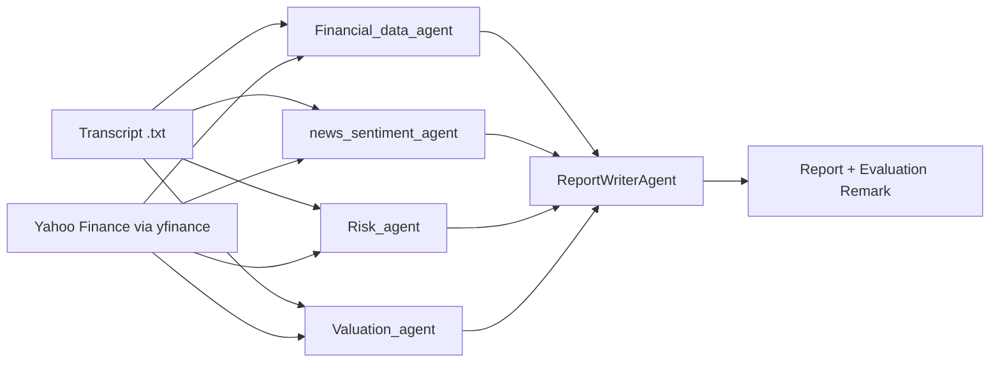

# Multi-Agent Fundamental Analysis

A Python command-line tool where five cooperating AI agents analyse a multinational company from its
**earnings call transcript** plus live **Yahoo Finance** data, then produce a Markdown report with an
**evaluation remark** (rating, conviction, rationale).

It runs on a **local Ollama model by default**, so no API key or usage cost is needed. OpenAI is supported as
an optional alternative.

## How it works



| Agent | Inputs | Output |
|---|---|---|
| `Financial_data_agent` | Revenue, margins, ROE, debt, cash flow, transcript | Financial health summary, strengths and weaknesses, guidance, score (1-10) |
| `news_sentiment_agent` | Recent Yahoo news, transcript tone | Sentiment, themes, catalysts, red flags, score (-1 to 1) |
| `Risk_agent` | Beta, leverage, drawdown, sector, transcript | Categorised risks (FX, geopolitical, regulatory, supply chain...), risk level, score (1-10) |
| `Valuation_agent` | Multiples, analyst targets, 3-scenario DCF, transcript outlook | Undervalued / fair / overvalued view, fair-value range, score (1-10) |
| `ReportWriterAgent` | All four agents' outputs | Final Markdown report with rating, conviction and rationale |

## Requirements

- Python 3.10 or newer
- [Ollama](https://ollama.com) installed and running, with at least one model pulled (for example `ollama pull llama3.1`)
- Internet access for Yahoo Finance data
- Optional: an OpenAI API key, only if you set `LLM_PROVIDER=openai`

## Installation

```bash
# 1. Create and activate a virtual environment
python -m venv .venv
# Windows:    .venv\Scripts\activate
# Mac/Linux:  source .venv/bin/activate

# 2. Install dependencies
pip install -r requirements.txt

# 3. Create your settings file
# Windows:    copy .env.example .env
# Mac/Linux:  cp .env.example .env
```

Run `ollama list` and set `OLLAMA_MODEL` in `.env` to the **exact** name shown there (for example `llama3.1:8b`).

## Usage

```bash
# With an earnings call transcript (recommended)
python main.py AAPL --transcript transcripts/aapl_q3.txt

# Non-US listings use Yahoo Finance symbols
python main.py NESN.SW --transcript transcripts/nestle.txt

# Without a transcript (Yahoo Finance data only)
python main.py MSFT

# Custom output folder
python main.py AAPL --transcript transcripts/aapl_q3.txt --out my_reports
```

### Run a single agent

Useful for testing one agent without running the whole pipeline. It prints that agent's JSON output:

```bash
python run_agent.py financial AAPL --transcript transcripts/aapl_q3.txt
python run_agent.py news MSFT
python run_agent.py risk NESN.SW
python run_agent.py valuation AAPL
```

**In VS Code:** open the folder, select the `.venv` interpreter, open **Run and Debug**, pick
**Full analysis (main.py)** or **Single agent (run_agent.py)**, press **F5**, then enter a ticker and an
optional transcript path.

### Arguments

| Argument | Required | Description |
|---|---|---|
| `ticker` | Yes | Yahoo Finance symbol, e.g. `AAPL`, `MSFT`, `NESN.SW`, `7203.T` |
| `--transcript` | No | Path to a `.txt` earnings call transcript |
| `--out` | No | Output folder (default `reports`) |

## Output

Each run writes two files to `reports/`:

- `<TICKER>_report.md`: the final report. Sections: Executive Summary, Financial Health, News & Management
  Sentiment, Risk Assessment, Valuation, Bull vs Bear Case, and the **Evaluation Remark** (Strong Buy / Buy /
  Hold / Reduce / Sell, with conviction level and what to monitor next quarter).
- `<TICKER>_agent_outputs.json`: the composite score plus the raw data and analysis from each agent, useful for
  checking the report.

## Configuration

Settings live in `.env` (see `.env.example`):

| Variable | Default | Purpose |
|---|---|---|
| `LLM_PROVIDER` | `ollama` | `ollama` or `openai` |
| `OLLAMA_MODEL` | `llama3.1` | Must match a name from `ollama list` |
| `OLLAMA_HOST` | `http://localhost:11434` | Ollama server address |
| `OLLAMA_NUM_CTX` | `8192` | Context window in tokens. Raise it if you have spare RAM/VRAM |
| `MAX_TRANSCRIPT_CHARS` | `12000` (Ollama), `60000` (OpenAI) | Transcript characters sent to each agent (about 4 per token). Raise together with `OLLAMA_NUM_CTX` |
| `MAX_WORKERS` | `1` (Ollama), `4` (OpenAI) | Number of agents run at once |
| `OPENAI_API_KEY` | none | Only needed when `LLM_PROVIDER=openai` |
| `OPENAI_MODEL` | `gpt-4o-mini` | Model used when `LLM_PROVIDER=openai` |

Long transcripts are trimmed to the limit by keeping the start (prepared remarks) and the end (Q&A).

## Project structure

```
fundamental_analysis_agents/
├── main.py                          # full pipeline (all agents -> report)
├── run_agent.py                     # run a single agent for testing/debugging
├── orchestrator.py                  # runs agents, composite score, report writing
├── agents/                          # one file per agent
│   ├── base_agent.py
│   ├── financial_data_agent.py
│   ├── news_sentiment_agent.py
│   ├── risk_agent.py
│   ├── valuation_agent.py
│   └── report_writer_agent.py
├── tools/                           # data + calculation functions used by the agents
│   ├── financial_tools.py           # statements, margins, ROE, cash flow
│   ├── news_tools.py                # Yahoo Finance headlines
│   └── evaluation_tools.py          # risk metrics, multiples, DCF, composite score
├── core/                            # shared plumbing
│   ├── config.py                    # settings from .env
│   ├── llm.py                       # Ollama / OpenAI wrapper, JSON parsing
│   ├── context.py                   # Context object + Yahoo Finance loader
│   └── utils.py                     # helpers (num, growth, transcript clipping)
├── requirements.txt
├── .env.example                     # copy to .env
├── .vscode/launch.json              # F5 run configurations
├── transcripts/                     # put transcript .txt files here
└── reports/                         # generated output (git-ignored)
```

## Composite score

Besides the written remark, the code computes a composite 1-10 score from the agents' scores, so the final
rating is anchored to numbers rather than only to the language model's wording (`composite_evaluation` in
`tools/evaluation_tools.py`).

| Component | Source | Weight |
|---|---|---|
| Financial | `Financial_data_agent` score (1-10) | 30% |
| Valuation | `Valuation_agent` score (1-10) | 30% |
| Risk | `Risk_agent` risk_score (1-10, 10 = safest) | 20% |
| Sentiment | `news_sentiment_agent` score (-1 to 1, rescaled to 1-10) | 20% |

Suggested rating: 8 or above Strong Buy, 6.5-8 Buy, 5-6.5 Hold, 3.5-5 Reduce, below 3.5 Sell. If an agent
fails or returns an invalid score, its weight is redistributed across the others and the gap is listed under
`missing`. The report writer is told to follow the suggested rating unless the evidence justifies a different one.

## Valuation method

The `Valuation_agent` runs a simple five-year free-cash-flow DCF in three scenarios:

| Scenario | FCF growth | Discount rate | Terminal growth |
|---|---|---|---|
| Bear | 3% | 11% | 1.5% |
| Base | 7% | 10% | 2.5% |
| Bull | 11% | 9% | 3.0% |

These are generic placeholders. Edit `DCF_SCENARIOS` in `tools/evaluation_tools.py` to suit the company. The DCF is
skipped when free cash flow is missing or negative.

## Extending

- **New data source:** add a function to the matching file in `tools/` and call it from the agent.
- **New agent:** create `agents/<name>_agent.py` subclassing `BaseAgent`, export it in `agents/__init__.py`,
  and add it to the `specialists` list in `orchestrator.py` (and to `AGENTS` in `run_agent.py`).
- **Different weights or rating cut-offs:** change `WEIGHTS` and the thresholds in `tools/evaluation_tools.py`.

## Troubleshooting

| Problem | Fix |
|---|---|
| `Cannot reach Ollama` | Start the Ollama app or run `ollama serve`, then retry |
| `Ollama model '...' not found` | Run `ollama list` and set `OLLAMA_MODEL` to an exact name shown |
| `model returned invalid JSON` in the agent outputs | Use a larger model; small models sometimes break JSON formatting |
| Very slow runs | Normal for local models. Use a smaller model or lower `MAX_TRANSCRIPT_CHARS` |
| Out-of-memory or crashes | Lower `OLLAMA_NUM_CTX` and `MAX_TRANSCRIPT_CHARS`, or use a smaller model |
| `Yahoo Finance returned no data` | Check the symbol; foreign tickers need a suffix such as `.SW`, `.T`, `.L` |
| Empty or missing financial fields | Yahoo coverage varies by company. The agents are told to say when data is missing |
| `command not found: python` | Try `python3`, or install Python 3.10+ |

## Limitations

- Yahoo Finance data through `yfinance` is unofficial and can be incomplete, delayed or rate-limited.
- Transcripts are not downloaded automatically. Supply them as `.txt` files.
- Language models can misread numbers or overstate conclusions. Check the report against
  `<TICKER>_agent_outputs.json` and the original filings.
- Local models in the 7-8B range give weaker analysis than larger models.

## Security

Never commit your `.env` file. It is listed in `.gitignore`. Share only `.env.example`.

## Disclaimer

This tool produces automated analysis for learning and research. It is **not investment advice**.
